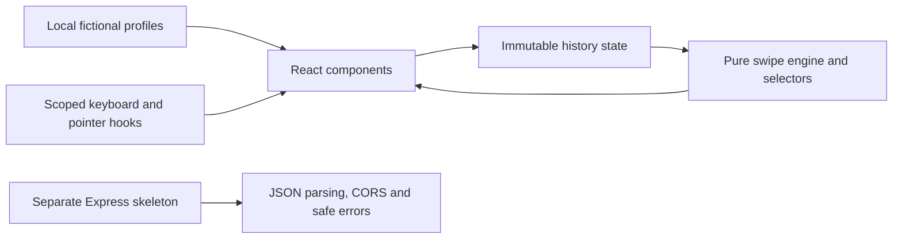

# Hẹn hò nhưng không yêu — Interactive Card-Swipe Deck

A Vietnamese card-swipe demonstration with six fictional adult profiles, original local illustrations, three swipe decisions, LIFO undo and an asymmetric emotion score. No real matching, messaging, accounts or payments are provided.

**Release scope, 2026-11-25:** P2-01–P2-08 and review/preparation P2-15–P2-17 are complete. The local frontend demonstration is verified. **P2-09–P2-14 remain pending**, so the full-stack application is not ready for release: business API routes, MongoDB persistence and frontend/backend integration do not exist. The backend is a tested Express skeleton with safe error handling.

**Final acceptance U011, 2026-11-25: NOT PASSED for the full-stack project.** Fresh checks passed 103 frontend tests, 10 backend skeleton tests, both lint checks, Vite build and backend syntax/smoke. A read-only connection/admin ping to the local example MongoDB URI also passed, but the application has no persistence or seeder. `npm.cmd run seed` actually failed with `Missing script: "seed"`. See the [complete 17-task acceptance matrix](verification/U011-acceptance.md), [MongoDB probe](verification/U011-mongodb.json) and [prompt audit](verification/U011-prompt-audit.json). No feature was added to hide these gaps.

## Technology stack

| Layer | Current implementation |
| --- | --- |
| Frontend | React 19, Vite 8, JavaScript ES modules, native CSS |
| Domain | Pure functions, JSDoc models and immutable interaction history |
| Backend | Express 5, CORS and dotenv; Node ES modules |
| Database | Mongoose 8 installed; connection, schemas, indexes and seed are not implemented |
| Verification | Vitest, React Testing Library, user-event, jest-dom, jsdom, Supertest, ESLint; optional local Chrome/CDP QA |

Lockfiles pin the installed dependency trees. No UI framework or router is needed for this single-view demo. All profile images are local; see [asset provenance](frontend/public/profiles/ASSETS.md).

## Functional requirements and business rules

- Present the current profile, remaining cards, score and newest-first interaction history. Provide empty-deck, completed-deck and empty-history states.
- Left / ArrowLeft = DISLIKE, **−5**. Right / ArrowRight = LIKE, **+10**. Up / ArrowUp = SKIP, **−5**. Negative scores are valid.
- Backspace or Undo removes the latest interaction; it never appends an undo/scoring action. Repeated undo restores cards in LIFO order.
- History is chronological, unique by profile ID, and matches the ordered deck prefix. Stable IDs and immutable updates preserve previous snapshots.
- Score is calculated with `history.reduce()` through `calculateScore`; current card and progress are selectors. There is no independent score/card state or synchronization effect.
- Keyboard shortcuts operate within the focused deck/card/controls. Held keys, repeats, composition, editable fields and modified shortcuts are ignored. Focus stays in the deck when a focused action becomes disabled.
- Pointer gestures use capture and a **50px inclusive threshold**. The dominant horizontal axis selects left/right; dominant upward motion skips. Downward, shorter and equally diagonal gestures do nothing. Release commits once; cancellation, lost capture or window focus loss resets the gesture. A history revision guard prevents an old drag from acting on a new card.
- Buttons provide alternatives to dragging. The card reserves touch movement for gestures; scroll outside the card. Reduced-motion preferences disable animation/transition.
- State belongs to one in-memory session and one fixed deck. **Reload resets decisions.** A different deck requires a new deck session; dynamic deck replacement is not implemented.

The precise model/function contract and accepted/rejected examples are in [DOMAIN_CONTRACT.md](DOMAIN_CONTRACT.md).

## System architecture



There is currently **no HTTP connection** from React to Express. `SwipeDeck` owns history; `ScoreBoard`, current card and progress derive from it. Hooks own transient gesture/held-key data and install cleaned-up focus-loss listeners. No request race or database consistency guarantee is claimed because networking/persistence are absent.

The Express factory is independent of the listener. `server.js` loads environment configuration and starts/stops the HTTP listener. Future routes must be registered before the 404/error fallbacks. Server-side profile/action validation, idempotency, session identity and transactional history/undo must be designed and tested in P2-09–P2-14.

## Directory structure

```text
Homework 2/
├── frontend/
│   ├── public/profiles/          # Original SVG portraits and asset record
│   ├── scripts/                 # Browser and environment verification
│   ├── src/
│   │   ├── components/          # Card, deck, controls, score, history and tests
│   │   ├── data/                # Frozen local fictional profiles
│   │   ├── domain/              # Models, pure engine and domain tests
│   │   ├── hooks/               # Keyboard and pointer event handling
│   │   ├── test/                # RTL cleanup and matcher setup
│   │   ├── App.jsx / App.css
│   │   └── main.jsx / index.css
│   └── package.json / package-lock.json
├── backend/
│   ├── src/app.js               # Express factory and fallbacks
│   ├── src/server.js            # Environment and listener lifecycle
│   ├── src/middleware/errors.js # Safe JSON error boundary
│   ├── tests/unit/              # Error-boundary tests
│   ├── tests/integration/       # Real HTTP skeleton checks via Supertest
│   ├── scripts/verify-setup.js
│   └── package.json / package-lock.json
├── verification/                # Actual browser reports/screenshots and release outputs
├── DOMAIN_CONTRACT.md
├── project-rules.md
├── TASK_DECOMPOSITION.md
├── AI_FAILURE_AUDIT.md
└── PROMPT_LOG.md
```

## Installation and startup

Verified toolchain: **Node v24.18.0 and npm 11.16.0**, Windows PowerShell. On Windows use `npm.cmd` when execution policy blocks `npm.ps1`; do not change policy for this project. On other systems use `npm`.

For a fresh checkout, run `npm.cmd ci` once in each package. Existing local dependencies were reused during this review; no reinstall was needed. Both development dependency sets are needed for full verification because backend lint reuses the frontend ESLint installation.

From the workspace root (`Lab4`), start the demo:

```powershell
cd 'Homework 2/frontend'
# Fresh checkout only: npm.cmd ci
npm.cmd run dev
```

Open Vite's printed Local URL, normally http://localhost:5173. **No backend, MongoDB or .env is required for the frontend demo.**

Optional backend skeleton, in a separate terminal from `Lab4`:

```powershell
cd 'Homework 2/backend'
# Fresh checkout only: npm.cmd ci
# Optional: Copy-Item .env.example .env
npm.cmd run dev
# Or: npm.cmd start
```

The listener defaults to port 3001. `SIGINT`/`SIGTERM` close the listener. Vite and backend scripts run from their package directories.

## Environment and database configuration

| Package / variable | Placeholder/default | Used now? |
| --- | --- | --- |
| Backend `PORT` | `3001` | Yes; integer 1–65535, invalid values reject startup |
| Backend `CLIENT_ORIGIN` | `http://localhost:5173` | Yes; configured CORS response origin |
| Backend `MONGODB_URI` | `mongodb://127.0.0.1:27017/interactive_card_deck` | **No**, reserved for future persistence |
| Backend `NODE_ENV` | Set `production` when hosting | Express runtime mode; error responses remain sanitized |
| Frontend `VITE_API_BASE_URL` | `http://localhost:3001` | **No**, reserved for a future API client |

Copy `.env.example` to `.env` only when needed. VITE-prefixed values are public build inputs, never secrets. Do not place MongoDB credentials in frontend configuration.

The **application is not connected to MongoDB**: there are no Mongoose models, migrations, seed commands or database tests. U011 independently confirmed that the local example MongoDB endpoint accepts a read-only Mongoose connection/admin ping; no data was written. That infrastructure check does not implement application persistence. Installing MongoDB or setting MONGODB_URI does not add persistence. P2-10 must introduce connection/error handling, schemas and seed; P2-14 must verify a real database. Do not present Supertest skeleton checks as database verification.

### Exact startup commands and seed availability

From `Lab4`, in frontend terminal A:

```powershell
cd 'Homework 2/frontend'
npm.cmd run dev
```

From `Lab4`, in a separate backend terminal B:

```powershell
cd 'Homework 2/backend'
npm.cmd start
```

Frontend is normally http://localhost:5173; backend defaults to http://localhost:3001 and currently serves only skeleton/fallback behavior. The frontend remains a local in-memory demo.

**Database seeding: no working project command exists.** The exact diagnostic below was executed from `Lab4` and failed; do not treat it as a functioning seeder:

```powershell
cd 'Homework 2/backend'
npm.cmd run seed
# Current result: Missing script: "seed" (exit 1)
```

There is no seed file/script/schema to invoke by another command. This acceptance-only request prohibits adding one. Complete P2-10 and persistence integration before claiming seed/database acceptance.

`.gitignore` excludes private `.env` variants, credentials, `node_modules`, `dist` and coverage; `.env.example` stays trackable. [Environment verification](verification/P2-16-environment.json) confirms current examples, invalid-port rejection, ignore probes and tracked-file exclusions without printing private values.

## REST API: actual current behavior

There are **no application success endpoints**. The following names are reserved project requirements, not implemented APIs:

| Method/path | Current result |
| --- | --- |
| `GET /api/profiles` | 404 JSON `NOT_FOUND`; no profiles are read from a database |
| `POST /api/swipe` with valid JSON | 404 JSON `NOT_FOUND`; no swipe is persisted |
| `GET /api/history` | 404 JSON `NOT_FOUND`; skeleton test only, no finalized history contract |
| Other unmatched paths/methods | 404 JSON `NOT_FOUND` |
| CORS preflight `OPTIONS` | 204 with the configured allowed-origin header; this does not establish business route support |

History/undo paths, request schemas, success status codes, identity, ordering, conflict/idempotency semantics and reload consistency remain P2-09 work. No fictional success response is documented here.

Try the running skeleton:

```powershell
curl.exe http://localhost:3001/api/profiles
curl.exe -X POST http://localhost:3001/api/swipe -H 'Content-Type: application/json' --data '{}'
```

Both return:

```json
{"error":{"code":"NOT_FOUND","message":"Route not found"}}
```

Shared parser/error responses have this same `{ "error": { "code", "message" } }` envelope:

| Status | Code | Meaning |
| --- | --- | --- |
| 400 | `INVALID_JSON` | Malformed JSON request body |
| 413 | `BODY_TOO_LARGE` | JSON body exceeds the existing 16kb limit |
| 415 | `UNSUPPORTED_BODY` | Unsupported request body charset/encoding |
| 500 | `INTERNAL_ERROR` | Unexpected error, without exposing parser messages/stacks |

CORS is a browser policy, not authentication. The skeleton is not a production business service. Domain validation on the client does not replace independent server validation in the future API.

## Tests, lint and production checks

From `frontend`:

```powershell
npm.cmd test
npm.cmd run lint
npm.cmd run build
node scripts/verify-environment.mjs
node scripts/verify-docs.mjs
npm.cmd run preview -- --host 127.0.0.1 --port 4173 --strictPort
```

From `backend`:

```powershell
npm.cmd test
npm.cmd run lint
npm.cmd run check
node scripts/verify-setup.js
```

The backend uses native Node ES modules and has **no bundling/transpilation build step**. Syntax, startup validation and real HTTP skeleton checks replace a nonexistent build. `test:watch` is available in both packages. Frontend domain tests use Node; component/input tests use jsdom. Backend tests are unit and HTTP-skeleton integration tests; there are no database suites.

### Initial review results — U007, 2026-11-25

| Check | Observed result and evidence |
| --- | --- |
| Frontend tests | **103 passed, 6 files**, [output](verification/P2-16-frontend-tests.txt) |
| Backend tests | **10 passed, 2 files**, [output](verification/P2-16-backend-GREEN.txt) |
| Frontend and backend lint | Passed; [frontend](verification/P2-16-frontend-lint.txt), [backend](verification/P2-16-backend-lint.txt) |
| Backend syntax/setup | Passed; [syntax output](verification/P2-16-backend-check.txt); setup script passed Express/CORS smoke |
| Frontend build | Passed, 28 modules; HTML 0.69kB, CSS 11.08kB, JS 234.88kB (gzip JS 74.16kB); [output](verification/P2-16-build.txt) |
| Production dependency audits | Both `npm audit --omit=dev` runs exited 0, **0 vulnerabilities**; [frontend](verification/P2-16-frontend-audit.json), [backend](verification/P2-16-backend-audit.json); dev dependencies not covered |
| Production browser | Passed on Vite production preview: keyboard/mouse, emulated touch/undo, loaded assets, visible focus, reduced motion, zero observed console/JS/network/HTTP errors; [report](verification/P2-16-BROWSER.json) |
| Responsive visual review | Screenshots visually inspected at [375px](verification/P2-15-375.png), [768px](verification/P2-15-768.png), [1440px](verification/P2-15-1440.png); no horizontal overflow in both dev and production checks |
| Contrast sampling | Ten text samples **4.62–5.75:1**; limited to sampled text, not an accessibility compliance audit |
| Lighthouse | **Not run**: no local CLI/package; manual steps below |
| Real MongoDB/full-stack persistence | **Not Verified**: implementation absent |

### Latest review results — U010, 2026-11-25

The repeated review used fresh checks and preserved the earlier evidence. It found and fixed a narrow reflow defect: body min-width:320px exceeded the 305px available after a scrollbar at a 320px viewport. The unchanged browser assertion failed before the fix and passes afterward, without hiding overflow.

| Check | Current actual result |
| --- | --- |
| Frontend tests/lint | **103 tests passed, 6 files**; lint passed during P2-15; [current source test output](verification/U010-P2-15-tests.txt) reused in P2-16 because source did not change |
| Backend tests/lint/syntax | **10 tests passed, 2 files**, lint/syntax/HTTP smoke passed; [tests](verification/U010-P2-16-backend-tests.txt), [lint](verification/U010-P2-16-backend-lint.txt), [syntax](verification/U010-P2-16-backend-check.txt) |
| Production frontend build | Passed, 28 modules; HTML 0.69kB, CSS **11.07kB**, JS 234.88kB (gzip JS 74.16kB); [build output](verification/U010-P2-16-build.txt) |
| Responsive and browser checks | Passed at **320/375/768/1440px**; no horizontal overflow, loaded images, skip navigation/visible focus, reduced motion none/0s, input/undo passed; [production report](verification/U010-P2-16-BROWSER.json) |
| Console/network checks | Zero observed console errors, JS exceptions, failed network requests or HTTP errors in the tested production flows |
| Visual inspection | [320px](verification/U010-P2-15-320.png), [375px](verification/U010-P2-15-375.png), [768px](verification/U010-P2-15-768.png), [1440px](verification/U010-P2-15-1440.png) screenshots inspected; ten sampled text contrasts >=4.5:1 |
| Environment/Git exclusions | Passed; private .env files/generated directories excluded, examples trackable, invalid PORT rejected; [fresh report](verification/U010-P2-16-environment.json) |
| Production dependency audits | Both fresh runs exited 0 with **0 reported vulnerabilities**; [frontend](verification/U010-P2-16-frontend-audit.json), [backend](verification/U010-P2-16-backend-audit.json) |
| Lighthouse and real persistence | Lighthouse CLI/package still unavailable, no score claimed; API/MongoDB/full-stack persistence still absent and Not Verified |

Task commits for this review: `62475be` — `fix(frontend): prevent overflow at narrow viewport widths`; `aeb3748` — `test(release): refresh production verification evidence`; final documentation commit — `docs(release): refresh final review and startup guidance`. Its actual self-hash is stored in its local development Git note after creation. No push is authorized or performed under U010.

P2-15 regressions were run before fixes: 3 failed/100 passed, then 103 passed. Backend initially had no tests; new skeleton tests ran RED 6 failed/2 passed, then passed after error hardening. All actual outputs are preserved under `verification/`; earlier historical outputs remain at the project root. See the [failure audit](AI_FAILURE_AUDIT.md) and [prompt/development log](PROMPT_LOG.md).

### Optional browser QA and manual accessibility checks

With the production preview running, from `frontend`:

```powershell
$env:PREVIEW_URL = 'http://127.0.0.1:4173'
$env:REPORT_PREFIX = 'U010-P2-16'
node scripts/verify-browser.mjs
```

Requires installed Chrome; override `CHROME_PATH` as needed. This restricted environment required `QA_NO_SANDBOX=1` for its isolated local headless renderer; the helper defaults to browser sandboxing. It closes its browser and leaves its temporary profile for OS cleanup. No browser package is installed by the helper. Current reports record `qaNoSandbox=true`.

To run Lighthouse manually: open the production preview in Chrome, open DevTools → Lighthouse, select navigation mode with Performance/Accessibility/Best Practices, and run both mobile and desktop audits. Save the HTML/JSON reports with date/browser version. No Lighthouse score is claimed in this repository.

Also verify Tab/Shift+Tab order, skip navigation, all arrow/undo controls, focus after completion, keyboard-only operation without dragging, 200% zoom/reflow, a real touchscreen and a screen reader. WCAG 2.2 AA is the target; sampled ratios/automated checks alone do not establish conformance. Physical touch, screen-reader use, full contrast/zoom audit and Lighthouse remain unverified.

## Publishing and atomic commit preparation

No commit, push or deployment was performed during U007's engineering review. U008 subsequently authorized and executed atomic commits for the pending work. Existing baseline e177567 is preserved; actual hashes are recorded in [PROMPT_LOG.md](PROMPT_LOG.md). Commit groups are:

```powershell
git add -- 'Homework 2/frontend/src' 'Homework 2/frontend/public'
git commit -m 'fix(frontend): preserve deck focus and improve accessibility'

git add -- 'Homework 2/backend'
git commit -m 'fix(backend): sanitize request errors and test Express skeleton'

git add -- 'Homework 2/frontend/eslint.config.js' 'Homework 2/frontend/scripts/verify-browser.mjs' 'Homework 2/frontend/scripts/verify-environment.mjs'
git commit -m 'test(release): add browser and environment verification'

git add -- 'Homework 2/README.md' 'Homework 2/frontend/README.md' 'Homework 2/project-rules.md' 'Homework 2/TASK_DECOMPOSITION.md' 'Homework 2/PROMPT_LOG.md' 'Homework 2/AI_FAILURE_AUDIT.md' 'Homework 2/frontend/scripts/verify-docs.mjs' 'Homework 2/verification'
git commit -m 'docs(homework-2): record release scope and atomic commit workflow'
```

The commands above describe the scoped grouping; do not rerun completed groups to manufacture duplicate or empty commits. Verification records were staged with their related groups. Going forward, U008 authorizes an atomic commit after each independent verified development task. The final documentation checkpoint's self-hash is recorded in its local Git note: `git log --show-notes=homework-2-development -1 -- "Homework 2/PROMPT_LOG.md"`.

Only publish with separate explicit permission. U009 previously authorized publication through commit a434272; U010 authorizes review and local task commits only, so **no new push is performed in this review**. For a future authorized publication, after checking the intended remote/branch, use `git push origin HEAD`. Local Git notes are not pushed by that ordinary branch command.

For a **static frontend demo**, build and upload only `frontend/dist/` to a static host serving the site at `/`. Example commands from `frontend` (replace the SSH destination with your own host):

```powershell
npm.cmd run build
scp -r dist/. deploy@your-host:/var/www/henho/
```

The destination must already be configured to serve that directory over HTTPS. `npm run preview` is a local verification server, not production hosting. For a subpath, configure Vite's base before rebuilding and verify local portrait URLs; current root-relative assets assume deployment at `/`.

On a fresh deployment copy, the optional backend skeleton can run from `backend` with:

```powershell
npm.cmd ci --omit=dev
$env:NODE_ENV = 'production'
$env:PORT = '3001'
$env:CLIENT_ORIGIN = 'https://your-domain.example'
npm.cmd start
```

It needs no frontend lint tooling at runtime. Hosting that skeleton does not deliver the missing API/database features; do not advertise it as a complete full-stack release.

## Known limitations and release blockers

- Final acceptance is not passed; every task criterion and the actual U011 results are recorded in verification/U011-acceptance.md. Four development-request entries U001/U002/U007/U010 are preserved; U010 repeats U007, so they are not four distinct implemented phases. No missing backend request was invented.

- P2-09–P2-14: no finalized business API contract, MongoDB connection/models/indexes/seed, application endpoints, durable sessions, idempotency, history/undo persistence or frontend API integration.
- Reload resets the demo; there is no cross-tab/device synchronization, authentication or durable state.
- Browser checks cover selected flows in headless Chrome with emulated touch, not physical devices or every browser/assistive technology.
- Lighthouse, physical touch, screen-reader, full WCAG/zoom audit, real database consistency and production host deployment remain unverified.
- Production audit found no reported dependency vulnerabilities at execution time; this is not a penetration test or complete security guarantee.
- Backend lint reuses the frontend development toolchain; install both packages for repository-wide development checks.

Release review/preparation is complete for the local demo. Full-stack release remains blocked until the pending tasks are implemented and verified.
